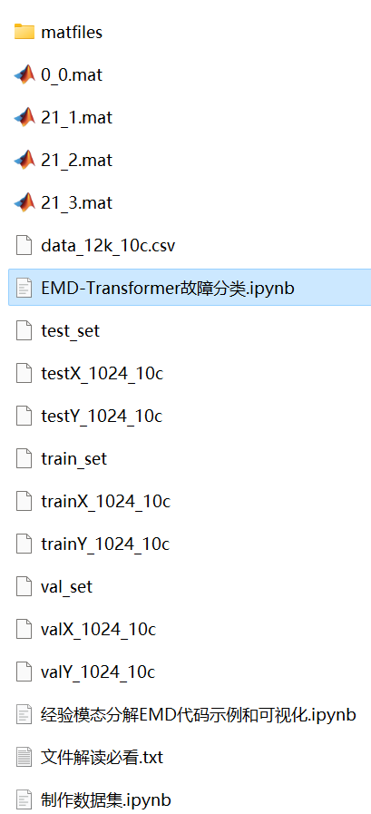

# EMD-Transformer bearing fault classification

Includes:
- Complete bearing fault dataset
- Already generated and preprocessed EMD decomposed fault signal dataset, classification data, and label set. All codes can be run. Also includes an example of EMD decomposition.
- Data EMD preprocessing code
- EMD-Transformer classification code
Environment: Python 3.9

## Images

<!-- PAYMENT_BLOCK -->

## Get this dataset

- Payment link (Stripe): [Buy now](https://buy.stripe.com/3cs8yP7sY87d0vu9AB)
- Payment QR code: 

<!-- /PAYMENT_BLOCK -->
